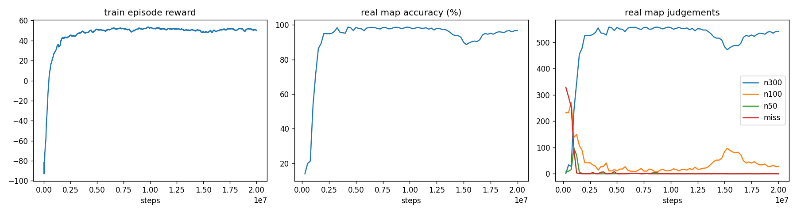

# osu_rl

**A PPO agent that plays osu!standard: circles, sliders, spinners, stacks, two keys, note lock. It trains in a Python simulator that matches osu!lazer's own judgement code.**

用強化學習（PPO）訓練一個會打 osu!standard 的 AI。它在自製的 Python 模擬器裡訓練，模擬器的判定逐條照 [ppy/osu](https://github.com/ppy/osu)（osu!lazer）原始碼重寫。每個結果都會輸出成 `.osr` replay，再丟進真正的 lazer 判定程式重新驗證。

## 結果

模型完全只用隨機生成的譜訓練，下面的真實譜一張都沒看過。最佳 checkpoint 用另外的驗證集挑選，詳見 [results](results/20261031-1933-timing120/results.md)。

| 測試集 | acc（平均 / 中位數） | FC | 平均 miss | autoplay |
|---|---|---|---|---|
| 26 張真實 ranked 譜（CS 3–9、AR 2–9.6、OD 2–9.2） | **97.8% / 99.0%** | **3 / 26** | 2.4 | 100% |
| 50 張沒看過的隨機譜 | 94.2% / 94.5% | — | 3.1 | 99.96% |

- **FC**：
  - 801165：1612 物件，combo 2359 / 2359，99.63%
  - 2593923：OD8.7，1429 / 1429
  - 1341554：877 / 877，99.26%
- 26 張真實譜的模型 replay 在 [results/…/replays/](results/20261031-1933-timing120/replays) 裡，都經過 osu!lazer 重新判定，**27407 / 27409（99.99%）個判定和模擬器完全一致**
- 目前最大的弱點是 **spinner**：真實譜 63 個 miss 裡有 59 個是 spinner，模型還不會轉。除了 spinner 和一張 CS9 的譜之外，其他物件一個都沒 miss

### 研究過程（完整紀錄在 [RESEARCH.md](RESEARCH.md)）

| 實驗 | 改了什麼 | 真實譜 acc |
|---|---|---|
| Exp 006 | 所有機制（slider、spinner、stacking、雙鍵、note lock），難度範圍 CS 3–5.5 / AR 7–10 / OD 5–9 | 93.2% |
| Exp 007 | 難度範圍擴大到 CS 2–7 / AR 3–10 / OD 2–10 | 97.2% |
| Exp 008 | 32 env 加速：快 1.6 倍，但學習變差，假設不成立 | 95.6% |
| Exp 009 | 加上連續時機獎勵（越接近完美時間獎勵越多） | **97.8%，3 FC** |

每一步都是一個先寫下來的假設：
- Exp 006 失分幾乎都來自訓練範圍外的難度，所以 Exp 007 擴大範圍。範圍外的真實譜從 86.6% 升到 96.6%，代價是時機變鬆、100 變多
- Exp 009 用時機獎勵補回這個缺點，100 少了一半以上，第一次出現 FC
- 錯誤分析發現剩下的 miss 幾乎都是 spinner，這是下一個要驗證的假設



## 這個專案在做什麼

1. **模擬器**（[env.py](env.py)、[beatmap.py](beatmap.py)）：Gymnasium 環境，120 Hz，整數 ms 時鐘。它讀取真正的 `.osu` 檔，涵蓋以下機制：
   - circle / slider / spinner
   - slider 的 L / P / B / C 四種曲線（含紅點分段、長度裁切）
   - 變速（SV）、tick / repeat / tail
   - follow circle 追蹤、stacking、K1 / K2 雙鍵
   - classic note lock（`LegacyHitPolicy`），以及 OD 對應的判定窗口
2. **訓練**（[train.py](train.py)）：每回合隨機生成一張 40 個物件的譜（[`random_osu`](beatmap.py)）。訓練從來不用真實譜，避免背譜。
3. **評估**（[evaluate.py](evaluate.py)）：
   - 用 5 張固定的驗證譜挑 checkpoint；
   - 在測試集上回報成績：26 張真實譜，加上 50 張沒看過的隨機譜；
   - 和腳本寫的完美玩家（autoplay）對照。
4. **驗證**（[verify.py](verify.py)、[lazer/TestSceneOsuRLReplay.cs](lazer/TestSceneOsuRLReplay.cs)）：模擬器打一次並寫出 `.osr`，osu!lazer 在 headless 模式播放這個 replay，最後逐個物件比對兩邊的判定。

### 模擬器有多準

模擬器準不準，決定了「模擬器裡 99%」在真遊戲裡是不是真的 99%。驗證方式是 fuzz：讓腳本玩家加上不同程度的雜訊去打譜，故意製造 miss、斷追蹤、亂按，再和 lazer 逐項比對。

| 驗證 | 一致的判定 |
|---|---|
| 30 張 fuzz 隨機譜 × 3 種雜訊 | 11264 / 11268（99.96%） |
| 26 張真實譜 × 3 種雜訊（autoplay） | 82112 / 82149（99.95%） |
| 26 張真實譜（訓練出的模型） | 27391 / 27409（99.93%） |

剩下的差異來自 lazer 在 replay 兩幀之間的更新時間不固定：同一個 replay 在 lazer 重播兩次，結果也可能不同。

過程中抓到並修正的差異（細節見 [RESEARCH.md](RESEARCH.md)）：
- lazer 判定窗口的取整方式 `floor(w) − 0.5`；
- lazer 會在 replay 兩幀之間用上一幀的按鍵更新遊戲；
- slider 子物件的判定順序；
- 400 ms 的 miss 邊界是嚴格小於；
- v8 以前的舊譜，tick 間距不受 SV 影響；
- 還有其他細節。

### 觀察 / 動作 / 獎勵

- **觀察（38 維）**：
  - 游標位置、兩個鍵的狀態、圓半徑、50 判定窗口；
  - 接下來 3 個物件的 [相對位置、距離打點時間、是否存在、是否為 slider、是否為 spinner]；
  - 正在進行的 slider 的狀態：是否在追蹤、剩餘時間、球未來 3 個時間點的相對位置；
  - 正在進行的 spinner 的狀態：完成度、剩餘時間、游標相對中心的位置。
- **動作（4 維）**：游標 dx、dy（上限 4.8 px/ms），K1、K2（> 0 為按住）。
- **獎勵**：
  - 300 = +1、100 = +0.4、50 = +0.1、miss = −1；
  - slider tick 中 +0.1、miss −0.3；
  - spinner 依完成度給分；
  - 空點 −0.05；
  - 朝目標靠近的距離 shaping。

## 使用方式

```bash
pip install -r requirements.txt
python test_env.py
```

用訓練好的模型打一張譜，輸出 replay（`--hz` 要和訓練時相同）：

```bash
python play.py path/to/map.osu --model results/20261031-1933-timing120/best_model.zip --hz 120 --out replay.osr
```

`.osr` 可以直接拖進 osu! 觀看（譜面要先在遊戲裡）。

訓練（20M 步約 1.5 小時，8 核 CPU）：

```bash
python train.py --steps 20e6 --hz 120 --gamma 0.995 --diff wide --timing 0.3 --name timing120 --eval-map maps/test/renatus_insane.osu
```

評估與 lazer 驗證都需要 ppy/osu 的 clone 和 .NET 10 SDK：

```bash
git clone https://github.com/ppy/osu ../ppy-osu
```

```bash
cp lazer/TestSceneOsuRLReplay.cs ../ppy-osu/osu.Game.Rulesets.Osu.Tests/
```

```bash
python get_maps.py
```

`get_maps.py` 會收集 25 張譜。第 26 張 BAKENOHANA [What Has Been Lost] 要自己從 osu! 下載，放進 `maps/test/bakenohana.osu`。

```bash
python evaluate.py runs/<run> --hz 120
```

```bash
python verify.py --fuzz 30 --noise 0 0.3 1.0 --hz 120 --out runs/verify/fuzz
```

`verify.py` 預設在 `%LOCALAPPDATA%\Microsoft\dotnet10` 找 .NET 10，ppy/osu clone 的位置用 `OSU_REPO` 環境變數指定。

## 專案結構

| 檔案 | 內容 |
|---|---|
| [beatmap.py](beatmap.py) | `.osu` 解析、slider 路徑、stacking、隨機譜生成 |
| [env.py](env.py) | Gymnasium 環境與判定邏輯 |
| [train.py](train.py) | PPO 訓練、驗證集評估、紀錄 |
| [play.py](play.py) | 模型或 autoplay 打譜，輸出 `.osr` |
| [replay.py](replay.py) | `.osr` 寫入 |
| [verify.py](verify.py) | 用 osu!lazer 重新判定並逐項比對 |
| [evaluate.py](evaluate.py) | checkpoint 挑選、測試集、輸出 `results/` |
| [get_maps.py](get_maps.py) | 從 ppy/osu 測試資源收集真實測試譜 |
| [RESEARCH.md](RESEARCH.md) | 研究紀錄：每個實驗的假設、設定、結果、觀察 |
| `results/` | 最終模型、測試結果、lazer 判定過的 replay、訓練曲線 |

## 限制

- 沒有 HP / 失敗：replay 播放時不會中途失敗，但真的玩會失敗。
- 沒有 mods（HR / DT / HD …），也沒有計算分數，只算判定、acc、combo。
- lazer 在 replay 兩幀之間的更新時間不固定。落在一幀最後 1 ms 內的事件，模擬器無法完全對齊；這類事件很少見。
- 驗證用的是 lazer 的 headless 判定程式，和遊戲畫面播放是同一套程式碼，但沒有逐張人工觀看。

## 倫理

這個專案只做離線訓練和 replay。不要在線上排行或多人遊戲用 bot 打譜：這違反 osu! 的規則，帳號會被封鎖，對其他玩家也不公平。

測試譜的版權屬於原作者，所以不收錄在 repo 裡，用 `get_maps.py` 從 ppy/osu 的測試資源取得。
