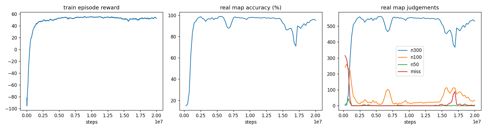

# osu_rl

**A PPO agent that plays osu!standard: circles, sliders, spinners, stacks, two keys, note lock. It trains in a Python simulator that matches osu!lazer's own judgement code.**

用強化學習（PPO）訓練一個會打 osu!standard 的 AI。它在自製的 Python 模擬器裡訓練，模擬器的判定逐條照 [ppy/osu](https://github.com/ppy/osu)（osu!lazer）原始碼重寫。每個結果都會輸出成 `.osr` replay，再丟進真正的 lazer 判定程式重新驗證。

## 結果

模型用隨機生成的譜，加上 5082 張 HF 真實 ranked 譜訓練。下面的測試譜都沒在訓練裡出現過（依 beatmapset 分開）。最佳 checkpoint 用另外的驗證集挑選，詳見 [results](results/20261101-0021-pool120/results.md)。

| 測試集 | acc（平均 / 中位數） | FC | 平均 miss | autoplay |
|---|---|---|---|---|
| 26 張真實 ranked 譜（CS 3–9、AR 2–9.6、OD 2–9.2） | **99.0% / 99.5%** | **12 / 26** | 0.7 | 100% |
| 60 張 HF 測試譜（另一批沒看過的 ranked 譜） | **99.4% / 99.6%** | **26 / 60**（15 張 SS） | 0.4 | 99.99% |
| 50 張沒看過的隨機譜 | 97.3% / 98.1% | 15 / 50 | 1.1 | 99.96% |

- **26 張真實譜裡有 6 張 SS（100%）**：100374、103019、1450162、1597806（CS7）、75858、renatus_hard
- **其他 FC**：
  - BAKENOHANA（AR9.6 OD9.2）：97.77%
  - 801165：1612 物件，combo 2359 / 2359
  - 2190499、42587、871815、renatus_normal
- 26 張真實譜的模型 replay 在 [results/…/replays/](results/20261101-0021-pool120/replays) 裡，都經過 osu!lazer 重新判定，**27394 / 27409（99.95%）個判定和模擬器完全一致**
- 剩下的弱點：
  - CS9 的譜（88%，超出訓練範圍）
  - 跳和 slider 頭的時機偶爾偏到 100

### 結果有多可靠

上面是單一訓練（seed 0）的成績。為了確認不是運氣，最後兩個設定各用 seed 1 再訓練一次，並改用更大的驗證集挑 checkpoint（H6，見 [RESEARCH.md](RESEARCH.md)）：

| 設定（2 個 seed 平均） | 26 張真實譜 acc | HF 60 張 acc | 真實譜 FC |
|---|---|---|---|
| 只用隨機譜訓練 | 98.20%（98.36 / 98.03） | 99.00% | 8.5 |
| 50% 真實譜訓練 | 98.24%（98.61 / 97.87） | **99.31%** | 7.5 |

- 換 seed 之後，acc 大約有 ±0.4% 的差異，FC 數的差異更大（同一個設定可以是 3 張或 12 張）
- 原本只用 5 張隨機譜當驗證集，會挑到時機或 slider 還沒練好的 checkpoint，seed 之間最多差到 3.5%。改用加入 20 段真實譜的驗證集之後，差距縮小到 0.3–0.7%
- 真實譜訓練的效果比單次實驗看起來的小：在 HF 測試譜上穩定好約 0.3%，在原本 26 張上看不出差異

### 研究過程（完整紀錄在 [RESEARCH.md](RESEARCH.md)）

| 實驗 | 改了什麼 | 真實譜 acc |
|---|---|---|
| Exp 006 | 所有機制（slider、spinner、stacking、雙鍵、note lock），難度範圍 CS 3–5.5 / AR 7–10 / OD 5–9 | 93.2% |
| Exp 007 | 難度範圍擴大到 CS 2–7 / AR 3–10 / OD 2–10 | 97.2% |
| Exp 008 | 32 env 加速：快 1.6 倍，但學習變差，假設不成立 | 95.6% |
| Exp 009 | 加上連續時機獎勵（越接近完美時間獎勵越多） | 97.8%，3 FC |
| Exp 010 | spinner 期間的距離 shaping：游標會回中心，但不按鍵，假設不成立 | 97.2% |
| Exp 011 | spinner 期間按鍵不算空點、不扣分 | 98.3%，10 FC |
| Exp 012 | 一半的回合改用 HF 真實譜（5082 張）訓練 | **99.0%，12 FC** |
| Exp 013 / 014 | 換 seed 重跑 Exp 011 / 012；改用更大的驗證集挑 checkpoint（H6） | seed 間差距 3.5% → 0.3–0.7% |

每一步都是一個先寫下來的假設，再用實驗驗證：
- Exp 006 失分幾乎都來自訓練範圍外的難度，所以 Exp 007 擴大範圍。範圍外的真實譜從 86.6% 升到 96.6%，代價是時機變鬆、100 變多
- Exp 009 用時機獎勵補回這個缺點，100 少了一半以上，第一次出現 FC
- 錯誤分析發現剩下 94% 的 miss 是 spinner，模型完全不會轉
- 診斷出兩個獎勵缺口：spinner 期間沒有距離 shaping，而且按鍵被當成空點扣分。Exp 010 補了第一個，Exp 011 補了第二個，spinner 從 0 / 59 變成 48 / 59 沒 miss
- Exp 012 加入真實譜訓練，單次看起來 miss 少了一半以上；但 Exp 013 / 014 換 seed 驗證後發現，大部分差異來自挑 checkpoint 的雜訊。改用更大的驗證集（H6）後，真實譜訓練只在 HF 測試譜上穩定好約 0.3%



## 這個專案在做什麼

1. **模擬器**（[env.py](env.py)、[beatmap.py](beatmap.py)）：Gymnasium 環境，120 Hz，整數 ms 時鐘。它讀取真正的 `.osu` 檔，涵蓋以下機制：
   - circle / slider / spinner
   - slider 的 L / P / B / C 四種曲線（含紅點分段、長度裁切）
   - 變速（SV）、tick / repeat / tail
   - follow circle 追蹤、stacking、K1 / K2 雙鍵
   - classic note lock（`LegacyHitPolicy`），以及 OD 對應的判定窗口
2. **訓練**（[train.py](train.py)）：每回合隨機生成一張 40 個物件的譜（[`random_osu`](beatmap.py)）。訓練從來不用真實譜，避免背譜。
3. **評估**（[evaluate.py](evaluate.py)）：
   - 用 5 張固定的驗證譜挑 checkpoint；
   - 在測試集上回報成績：26 張真實譜，加上 50 張沒看過的隨機譜；
   - 和腳本寫的完美玩家（autoplay）對照。
4. **驗證**（[verify.py](verify.py)、[lazer/TestSceneOsuRLReplay.cs](lazer/TestSceneOsuRLReplay.cs)）：模擬器打一次並寫出 `.osr`，osu!lazer 在 headless 模式播放這個 replay，最後逐個物件比對兩邊的判定。

### 模擬器有多準

模擬器準不準，決定了「模擬器裡 99%」在真遊戲裡是不是真的 99%。驗證方式是 fuzz：讓腳本玩家加上不同程度的雜訊去打譜，故意製造 miss、斷追蹤、亂按，再和 lazer 逐項比對。

| 驗證 | 一致的判定 |
|---|---|
| 30 張 fuzz 隨機譜 × 3 種雜訊 | 11264 / 11268（99.96%） |
| 26 張真實譜 × 3 種雜訊（autoplay） | 82112 / 82149（99.95%） |
| 26 張真實譜（訓練出的模型） | 27391 / 27409（99.93%） |

剩下的差異來自 lazer 在 replay 兩幀之間的更新時間不固定：同一個 replay 在 lazer 重播兩次，結果也可能不同。

過程中抓到並修正的差異（細節見 [RESEARCH.md](RESEARCH.md)）：
- lazer 判定窗口的取整方式 `floor(w) − 0.5`；
- lazer 會在 replay 兩幀之間用上一幀的按鍵更新遊戲；
- slider 子物件的判定順序；
- 400 ms 的 miss 邊界是嚴格小於；
- v8 以前的舊譜，tick 間距不受 SV 影響；
- 還有其他細節。

### 觀察 / 動作 / 獎勵

- **觀察（38 維）**：
  - 游標位置、兩個鍵的狀態、圓半徑、50 判定窗口；
  - 接下來 3 個物件的 [相對位置、距離打點時間、是否存在、是否為 slider、是否為 spinner]；
  - 正在進行的 slider 的狀態：是否在追蹤、剩餘時間、球未來 3 個時間點的相對位置；
  - 正在進行的 spinner 的狀態：完成度、剩餘時間、游標相對中心的位置。
- **動作（4 維）**：游標 dx、dy（上限 4.8 px/ms），K1、K2（> 0 為按住）。
- **獎勵**：
  - 300 = +1、100 = +0.4、50 = +0.1、miss = −1；
  - slider tick 中 +0.1、miss −0.3；
  - spinner 依完成度給分；
  - 空點 −0.05；
  - 朝目標靠近的距離 shaping。

## 使用方式

```bash
pip install -r requirements.txt
python test_env.py
```

用訓練好的模型打一張譜，輸出 replay（`--hz` 要和訓練時相同）：

```bash
python play.py path/to/map.osu --model results/20261101-0021-pool120/best_model.zip --hz 120 --out replay.osr
```

`.osr` 可以直接拖進 osu! 觀看（譜面要先在遊戲裡）。

或用 `watch.py`：給它一個 `.osz`，它會幫每個 osu!standard 難度產生 replay，存到指定資料夾。加 `--open` 會用本機 build 的 osu!lazer 一起匯入譜面和 replay（lazer 匯入 `.osz` 後會刪掉檔案，所以交給它的是輸出資料夾裡的複本）：

```bash
python watch.py "path/to/map.osz" --out replays/my_map --diff Hard --open
```

訓練需要真實譜。資料來源是 Hugging Face 的 [project-riz/osu-beatmaps](https://huggingface.co/datasets/project-riz/osu-beatmaps)，下面的指令會串流下載一個分片（約 1GB），只留下 osu!standard 的 `.osu` 檔，音檔不會寫進硬碟：

```bash
curl -sL https://huggingface.co/datasets/project-riz/osu-beatmaps/resolve/main/compressed/data-000000.tar | python get_hf_maps.py -
```

這些譜依 osu! 服務條款只能用於研究，所以只放在本機的 `maps/hf/`，不收錄進 repo。

訓練（20M 步：Windows 純 CPU 約 1.5 小時；Linux / WSL2 加 `--device hybrid` 約 1 小時，需要 CUDA 版 PyTorch）：

```bash
python train.py --steps 20e6 --hz 120 --gamma 0.995 --diff wide --timing 0.3 --spin-shaping --spin-free-press --pool maps/hf/train --pool-frac 0.5 --device hybrid --name pool120 --eval-map maps/test/renatus_insane.osu
```

錯誤分析，以及在 HF 測試譜上評估：

```bash
python analyze.py results/<run>/best_model.zip maps/test/*.osu --hz 120
```

```bash
python eval_hf.py results/<run> --hz 120
```

### 只看畫面的學生（Exp 019）

`student.py` 訓練一個只看畫面（`gpu_render.py` 畫出的 160×120 灰階畫面）的學生，模仿讀譜面的 RL 老師（DAgger），設計和成功標準在 [RESEARCH.md](RESEARCH.md) 的 Exp 019。

需要 Linux 或 WSL2 和 NVIDIA GPU：

1. 照 [pytorch.org](https://pytorch.org/get-started/locally/) 裝 CUDA 版 PyTorch，再裝其他套件：

   ```bash
   pip install -r requirements.txt
   ```

2. 裝 Python 的開發標頭檔（Triton 編譯 GPU kernel 要用），版本跟你的 Python 一樣，例如 Python 3.12：

   ```bash
   sudo apt install python3.12-dev
   ```

3. 準備譜面：`maps/hf/`（train / val / test）和 `maps/test/`（26 張真實譜）。要跟之前的實驗用同一份切分，就從已經有的機器整個複製 `maps/` 過去；這些譜只能自己留著做研究，不要上傳或公開。

4. 冒煙測試（幾分鐘，只確認流程跑得通，成績接近 0 是正常的）：

   ```bash
   python student.py --smoke
   ```

5. 正式訓練。同時跑模擬器的程序數會自動設成「這台能用的 CPU 核心數減 2」（會看 CPU 親和性和容器的 CPU 配額），開頭會印出來。一台同時跑幾個 seed，就加 `--share` 平分核心。訓練要跑一段時間，用 `nohup` 讓它在斷線後繼續跑。只跑一個 seed：

   ```bash
   mkdir -p runs && nohup python student.py --seed 0 > runs/019-s0.log 2>&1 &
   ```

   同一台同時跑兩個 seed（例如閒置的 H100，顯存很夠，CPU 核心兩邊平分）：

   ```bash
   mkdir -p runs && nohup python student.py --seed 0 --share 2 > runs/019-s0.log 2>&1 &
   ```

   ```bash
   nohup python student.py --seed 1 --share 2 > runs/019-s1.log 2>&1 &
   ```

   ```bash
   tail -f runs/019-s0.log
   ```

   RTX 4060 筆電（16 執行緒）跑一個 seed 約 2 小時。每輪會印出收集了多少步、訓練速度和驗證準度。

6. 結果在 `results/experiments/019-student/seed<N>/`：每輪的模型 `round0.pt`–`round3.pt`，以及 `summary.json`（挑到哪一輪、每輪的驗證準度、真實譜 / HF 測試譜 / 加 20 ms 延遲的 lazer 準度）。把 `summary.json` 和挑到的那一輪模型 commit 回來，再對照 RESEARCH.md 裡預先登記的三個標準記錄結果。

評估與 lazer 驗證都需要 ppy/osu 的 clone 和 .NET 10 SDK：

```bash
git clone https://github.com/ppy/osu ../ppy-osu
```

```bash
cp lazer/TestSceneOsuRLReplay.cs ../ppy-osu/osu.Game.Rulesets.Osu.Tests/
```

```bash
python get_maps.py
```

`get_maps.py` 會收集 25 張譜。第 26 張 BAKENOHANA [What Has Been Lost] 要自己從 osu! 下載，放進 `maps/test/bakenohana.osu`。

```bash
python evaluate.py runs/<run> --hz 120
```

```bash
python verify.py --fuzz 30 --noise 0 0.3 1.0 --hz 120 --out runs/verify/fuzz
```

`verify.py` 用 `DOTNET_ROOT` 環境變數找 .NET 10（沒設定時用 Windows 的 `%LOCALAPPDATA%\Microsoft\dotnet10`），ppy/osu clone 的位置用 `OSU_REPO` 環境變數指定。

## 跟 AI 在 lazer 多人房一起打

[live/](live/README.md) 讓 AI 用一個普通帳號連上 osu! 私人伺服器（例如 [Illyaverse](https://github.com/Illyavrs/Illyaverse)），跟玩家在同一個 lazer 多人房裡打：自動準備、即時排行看得到它、可以觀戰它的游標、結算有它的成績。分數由 headless lazer 計算，和真人打出來的完全同一套。

```bash
python -m live.service --port 8765
```

Discord 機器人透過 HTTP 控制它（進房、離開、換難度、單人打一張譜）；[live/tools.json](live/tools.json) 是 OpenAI function calling 格式的 tool 定義。設定方式、API 和 TS 範例見 [live/README.md](live/README.md)。

## 一起驗證假設

每個假設都寫成一個設定檔，放在 [experiments/](experiments/)，各參數的意思見 [experiments/README.md](experiments/README.md)。內容包括：
- 假設本身；
- 訓練參數；
- 可以自動檢查的成功標準。完整的事先登記（操作變因、控制變因、理由）在 RESEARCH.md。

任何人都可以用不同的 seed 重跑同一個假設：

```bash
python run.py experiments/015-tail-miss.json --seed 2
```

這個指令會依序：
1. 照設定檔訓練；
2. 用 25 張驗證譜挑 checkpoint（H6）；
3. 打 26 張真實測試譜和 60 張 HF 測試譜；
4. 把結果和選出的模型寫進 `results/experiments/<id>/seed<N>/`。

成功標準是用多個 seed 的平均來判定的，單一 seed 的通過 / 不通過只能當參考。加上 `--dry-run` 只會印出訓練指令，不會真的跑。

## 專案結構

| 檔案 | 內容 |
|---|---|
| [beatmap.py](beatmap.py) | `.osu` 解析、slider 路徑、stacking、隨機譜生成 |
| [env.py](env.py) | Gymnasium 環境與判定邏輯 |
| [train.py](train.py) | PPO 訓練、驗證集評估、紀錄 |
| [play.py](play.py) | 模型或 autoplay 打譜，輸出 `.osr` |
| [run.py](run.py) | 照 `experiments/*.json` 跑一個 seed：訓練 → 挑 checkpoint → 測試 → summary |
| [select_ckpt.py](select_ckpt.py) | 用 25 張驗證譜重新挑 checkpoint（H6） |
| [watch.py](watch.py) | `.osz` 每個難度產生 replay 到指定資料夾，可直接用 lazer 打開 |
| [replay.py](replay.py) | `.osr` 寫入 |
| [verify.py](verify.py) | 用 osu!lazer 重新判定並逐項比對 |
| [evaluate.py](evaluate.py) | checkpoint 挑選、測試集、輸出 `results/` |
| [get_maps.py](get_maps.py) | 從 ppy/osu 測試資源收集真實測試譜 |
| [get_hf_maps.py](get_hf_maps.py) | 從 HF 資料集抽出 osu!standard 譜，依 beatmapset 切 train / val / test |
| [eval_hf.py](eval_hf.py) | 在 60 張 HF 測試譜上評估 |
| [analyze.py](analyze.py) | 錯誤分析：依情境統計 miss / 100 / 50 |
| [grouped_vec_env.py](grouped_vec_env.py) | 一個 process 跑多個 env（Exp 008） |
| [dashboard.py](dashboard.py) | 區網狀態網頁（訓練 / 評估進度） |
| [queue_runs.py](queue_runs.py) | 依序跑多個實驗 / seed |
| [plot.py](plot.py) | 畫訓練曲線 |
| [live/](live/README.md) | AI 玩家：連上私人伺服器的 lazer 多人房，給 Discord 機器人的 HTTP API 和 tool 定義 |
| [lazer/](lazer/) | 放進 ppy/osu 的 headless 測試：判定比對（Replay）、AI 計分（Live）、RL Bot mod 測試（Bot） |
| [merge_ppyosu/](merge_ppyosu/README.md) | 實驗性的 lazer「RL Bot」Automation mod（C# 推論，不連線） |
| [experiments/](experiments/README.md) | 每個假設的設定檔 |
| [RESEARCH.md](RESEARCH.md) | 研究紀錄：每個實驗的假設、設定、結果、觀察 |
| `results/` | 最終模型、測試結果、lazer 判定過的 replay、訓練曲線 |

## 限制

- 沒有 HP / 失敗：replay 播放時不會中途失敗，但真的玩會失敗。
- 只學過不開 mod 的譜（HR / DT / HD …）。模擬器本身只算判定、acc、combo；要 lazer 分數時（live/）交給 headless lazer 計算。
- lazer 在 replay 兩幀之間的更新時間不固定。落在一幀最後 1 ms 內的事件，模擬器無法完全對齊；這類事件很少見。
- 驗證用的是 lazer 的 headless 判定程式，和遊戲畫面播放是同一套程式碼，但沒有逐張人工觀看。

## 倫理

不要在官方 osu! 伺服器用 bot 打譜：這違反 osu! 的規則，帳號會被封鎖，對其他玩家也不公平。[live/](live/README.md) 只用在伺服器管理員同意、玩家都知道對手是 AI 的私人伺服器上。

測試譜的版權屬於原作者，所以不收錄在 repo 裡，用 `get_maps.py` 從 ppy/osu 的測試資源取得。
